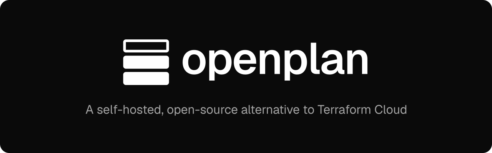
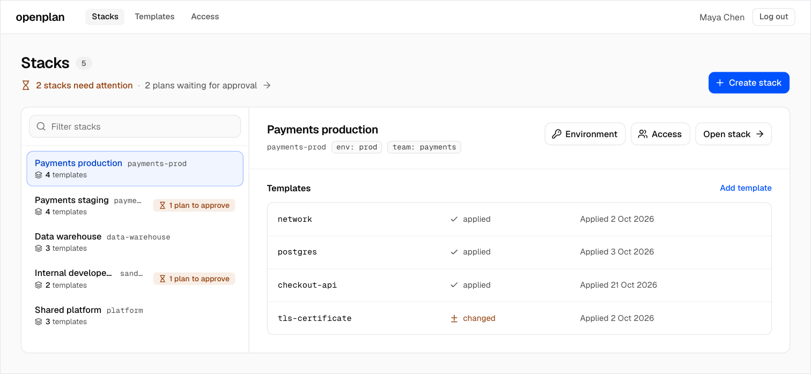
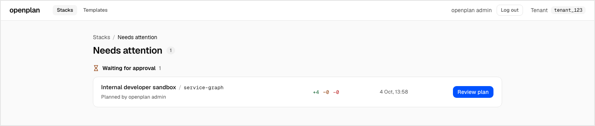
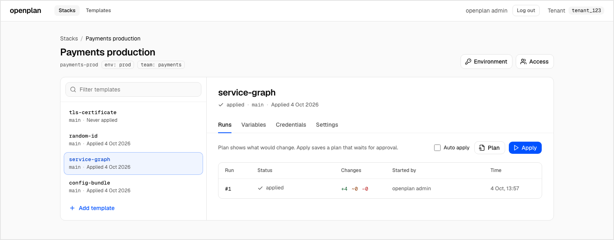
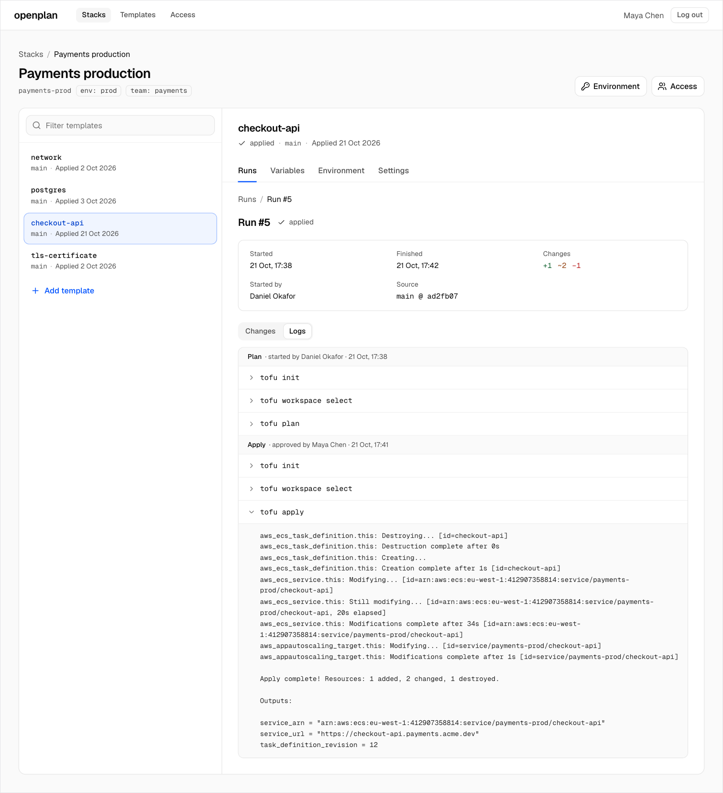
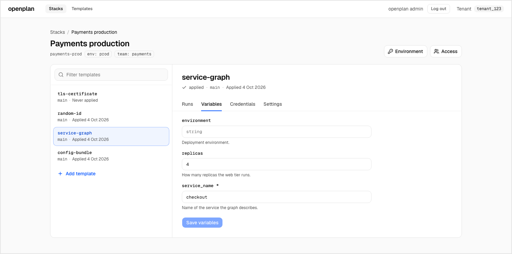
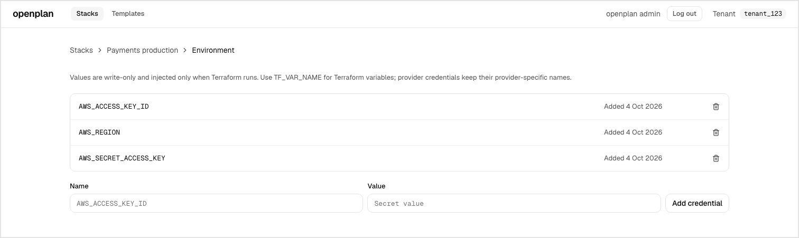
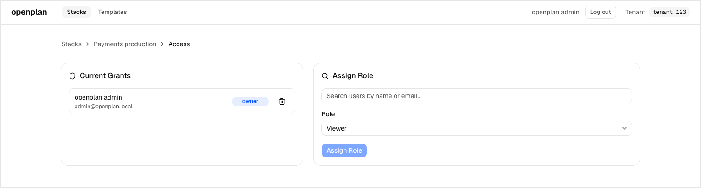
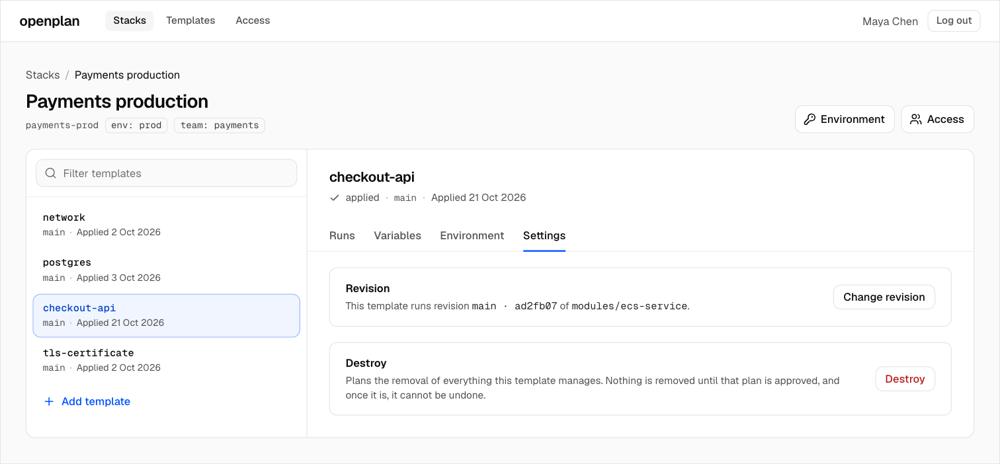

[](https://github.com/openplanhq/openplan/actions/workflows/ci.yml)
[](https://github.com/openplanhq/openplan/actions/workflows/differential.yml)
[](LICENSE)
[](go.mod)
[](web/package.json)



## Features

- **Template Registry** - Point openplan at a Git repository and a revision. That
  becomes a reusable template anyone on the platform can install.
- **Stacks** - A stack groups the templates that make up one environment
  or one service, each with its own configuration.
- **Variable Management** - Vars are parsed on template registration and saved on template installation. 
- **Plan, apply and destroy from the browser** - Runs are durably orchestrated on
  Temporal, so a plan or apply survives a restart rather than being lost halfway.
- **RBAC** - Grant people access to the stacks they need, rather than to everything.
- **Environment** - Configure environment at stack level or template level.
- **Sign in with SSO** - openplan signs in through [Dex](https://dexidp.io), its
  identity provider in every deployment. A corporate IdP, GitHub, or LDAP plugs
  in as a Dex connector, and the local stack ships Dex preconfigured, so there
  is nothing to wire up to try it.

## Screenshots

**What needs attention** Plans waiting for approval and destroys that failed,
across every stack you can see.



**Templates and runs** - The templates a stack is built from, the plan and apply
controls, and the run history, all on one screen.



**Runs and logs** - Every run keeps its status, its timings, and the full `init`,
`plan` and `workspace` output.



**Variables.** The input variables openplan inferred from the module, editable
per stack.



**Credentials.** Cloud credentials and other environment variables are
injected only while Terraform runs. Secrets are write-only; a value marked
not sensitive, such as a region, can be read back.



**Access.** Grant people a role on the stacks they need, not on everything.



**Settings.** The revision a template runs, where you change it, and Destroy,
which plans the removal of everything the template manages.



## Running it locally

Requires Docker. No Go or Node toolchain.

### Without a checkout

Download three files and run one command:

```bash
url=https://github.com/openplanhq/openplan/releases/latest/download
curl -LO $url/docker-compose.release.yaml
curl -LO $url/dex.yaml
curl -LO $url/init-databases.sh
docker compose -f docker-compose.release.yaml up -d
```

Keep the three files in the same directory. It takes a minute or two.

Every release carries its own copy of these three files, pinned to that release.
`latest` gets the newest one; for another, use
`releases/download/<version>` in place of `releases/latest/download`.

**Then open http://localhost:5173** and sign in as
`admin@openplan.local` / `admin-local-only`.

### From a checkout

To run the latest development version, or to work on openplan itself:

```bash
git clone https://github.com/openplanhq/openplan.git
cd openplan
cp .env.example .env
docker compose up -d --wait
```

**Then open http://localhost:5173** and sign in as
`admin@openplan.local` / `admin-local-only`.

> [!IMPORTANT]
> Use `localhost`, not `127.0.0.1` when you open the UI or sign in. Only
> `localhost` is registered as a valid sign-in origin, so `127.0.0.1` fails with
> an invalid `redirect_uri`.

### Pinning a version, and building from source

`docker compose up` runs `latest`, which is the latest release. To pin a
specific version, set it in `.env`:

```bash
OPENPLAN_IMAGE_TAG=0.2.0
```

If you are changing openplan itself rather than running it, build from source so
a published image cannot shadow your edit:

```bash
OPENPLAN_PULL_POLICY=build docker compose up -d --build
```

### Try it with the demo templates

[`openplanhq/demo-templates`](https://github.com/openplanhq/demo-templates)
holds small Terraform modules that need **no cloud credentials**. They use
only the built-in `terraform_data` resource and the `random`, `tls` and `local`
providers. Register one, install it into a stack, and a real plan and apply will
run end to end without an AWS account.

### Stopping it

```bash
docker compose down
```

### Starting over

To wipe everything and begin from a clean slate:

```bash
docker compose down -v
docker compose up -d --wait
```

### Optional extras

```bash
docker compose --profile s3 up -d      # MinIO, for S3-backed artifacts
docker compose --profile debug up -d   # Temporal UI on http://localhost:8080
```

### Upgrading

Upgrade in place, on the same volumes. Stacks, runs, credentials, grants and
sessions carry over: the api migrates the database when it starts, and runs in
flight carry on under the new release.

Without a checkout, download the new release's three files over the old ones,
with the new version in the URLs, and start again:

```bash
docker compose -f docker-compose.release.yaml up -d
```

From a checkout, pull and restart. If you pinned `OPENPLAN_IMAGE_TAG`, raise it
first:

```bash
git pull
docker compose pull
docker compose up -d --wait
```

Upgrade one release at a time: each release is written to read the state the
one before it left.

> [!NOTE]
> **On v0.3.0 or earlier?** Run `docker compose down -v` before starting the
> new release. Releases up to v0.3.0 could change state without migrating it,
> so a preserved volume can hold state the new code cannot read.

## Documentation

- [Local development](docs/development.md)
- [Install on Kubernetes with Helm](deploy/helm/openplan/README.md)
- [Architecture and product model](docs/architecture.md)
- [Apply run sequence](docs/apply-run-sequence.md)
- [Authentication and authorization](docs/authentication.md)
- [Authentication and authorization security architecture](docs/security-architecture.md)
- [API reference](docs/openapi.yaml)
- [Postman collection](postman/export/openplan-api.postman_collection.json), generated from the API reference: import it with its [environment](postman/export/openplan-local.postman_environment.json)

## Contributing

See [CONTRIBUTING.md](CONTRIBUTING.md). `make lint` and `go test ./...` from the
repository root, `npm test` and `npm run build` from `web/`, and `npm run build`
from `site/`. CI runs all of them.

## License

[Apache 2.0](LICENSE).
