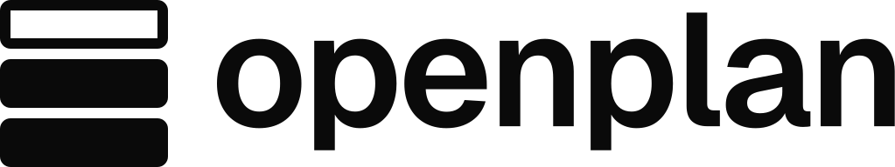
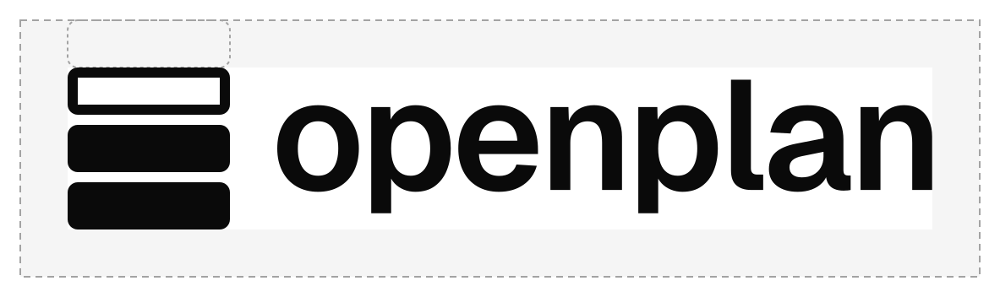
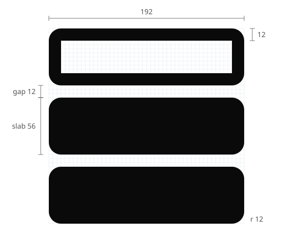

# openplan logo

<picture>
  <source media="(prefers-color-scheme: dark)" srcset="svg/openplan-logo-horizontal-white.svg">
  
</picture>

**The idea:** a stack of three layers. The bottom two are solid, already applied. The top one is only an
outline: the layer the plan will add. Stacks are openplan's core noun, and the outline is the plan you review
before you apply it.

## Which file to use

| Need | File |
|---|---|
| Default, light backgrounds | `svg/openplan-logo-horizontal.svg` |
| Dark backgrounds | `svg/openplan-logo-horizontal-white.svg` |
| Pure black for print | `svg/openplan-logo-horizontal-black.svg` |
| Square or narrow spaces | `svg/openplan-logo-stacked*.svg` |
| Symbol alone (avatars, app chrome) | `svg/openplan-symbol*.svg` |
| Name alone, where the symbol already appears nearby | `svg/openplan-wordmark*.svg` |
| Browser tab, home screen, PWA | `web/` (see `web/head-snippet.html`) |
| GitHub org avatar | `web/icon-512.png` |
| Link previews (GitHub social preview, chat unfurls) | `social/openplan-social-preview.png` (1280 × 640) |
| Banner atop a README or docs page | `banner/openplan-readme-banner.svg` (1280 × 400; `.png` alongside) |
| Docs, slides, office tools | `png/` (transparent) |
| Printers | `pdf/` (vector) |

Files without a suffix are ink. `-white` files are drawn a little lighter, so they don't look heavy on a dark
ground. Use SVG wherever the tool accepts it.

## Clear space and minimum size

Keep **one slab height** clear on every side: about 29% of the symbol's height. The zone scales with the logo.

| Version | Screen | Print |
|---|---|---|
| Horizontal | 96 px wide | 25 mm wide |
| Stacked | 80 px wide | 20 mm wide |
| Symbol | 24 px | 6 mm |
| Wordmark | 64 px wide | 18 mm wide |

Below 24 px, don't scale the symbol down: use the favicon tiles in `web/`. They are drawn separately on the
pixel grid at 16 and 32 px so the hollow layer stays visible.

## Colour

The logo is one colour. The outline, not a colour, marks the planned layer, so the mark reads the same in any
single ink.

| Name | HEX | RGB | CMYK | Use |
|---|---|---|---|---|
| Ink | `#0a0a0a` | 10 10 10 | 0 0 0 96 | Default logo; the UI's `--foreground` |
| White | `#ffffff` | 255 255 255 | 0 0 0 0 | Logo on dark grounds |
| Black | `#000000` | 0 0 0 | 0 0 0 100 | One-colour print |

Approved pairs: ink on white or the UI canvas (`#fafafa`); white on ink, on the UI blue (`#0052ff`), or on a
calm area of a photo; black on white for print.

## Type

The wordmark is Geist Semibold (weight 600), tracked -0.02em with Geist's own kerning: the same face, weight and
tracking as the app header, converted to outlines. The white wordmark is cut at weight 570 to offset the glow of
light type on dark. Never retype the name in place of the wordmark file.

Geist is licensed under the SIL Open Font License 1.1, which allows its use in a logo.

## Construction

- On a 4-unit grid, three slabs 192 × 56, 12 apart, corner radius 12. The top slab is an outline 12 thick
  (the same as the gaps and the radius) with square inner corners.
- Horizontal lockup: the wordmark's x-height is 98 units, centred on the symbol, with one slab height (56)
  between symbol and word.
- Stacked lockup: x-height equals one slab height, with one slab height between the symbol and the x-height.

## Don't

- Stretch, squash, rotate, or redraw the logo.
- Fill the outlined layer, or outline the solid ones; the difference is the idea.
- Give the layers different colours; the logo is one colour.
- Add shadows, gradients, glows, or strokes.
- Change the spacing or the size relation between symbol and wordmark.
- Place it on a busy background without a calm area or a tile.

## Handover notes

**Why these choices.**
- *One colour:* a blue planned layer was tried and dropped, because it read like an empty input field.
- *A 12-unit outline:* in ink, a 16-unit outline turned the top slab into a heavy frame. At 12, the outline,
  the gaps and the corner radius share one measurement.
- *Heavy slabs with tight gaps:* they keep the mark from reading as a menu icon.
- *The wordmark:* it is the product's own header type, so the logo and the app read as one.

**Tests run.**
- **SVG audit:** 98–100 on every master, with info notes only: anchor counts from the letter outlines.
- **Size ladder, reversed, and the app-icon, favicon and website contexts:** all hold.
- **16 px pixel test:** the 32 px tile scaled down to 16 smears the hollow layer, so 16 px has its own drawing.

**Open items.**
- **Trademark:** run a trademark search before public launch; clearance was not checked.
- **AI/EPS masters:** none; the PDFs are vector.
- **Wired in:**
  - the favicon (`favicon.ico`, `apple-touch-icon.png`) in the app (`web/public/`) and the site (`site/public/`)
  - the banner at the top of the root README; it is ink in both GitHub themes
- **GitHub settings, set by hand:** the social preview (repository Settings → General → Social preview) and
  the org avatar (organization Settings → Profile). Neither can be set from the repository.
- **Not wired in yet:** the header lockup in the app and on the site, and the logo in the openplan UI design
  system.
- **Source:** the SVGs are the source of truth. They were generated by a script that is not in this repo, and the
  construction above is enough to redraw them.
